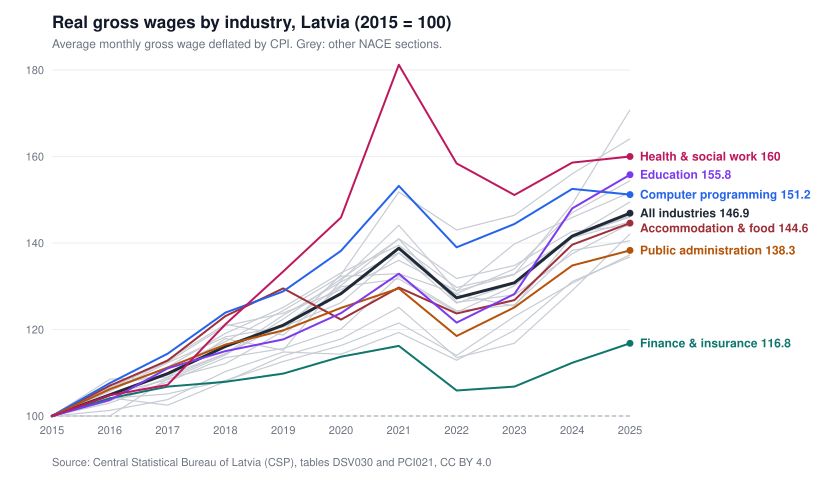

# Latvia: real wages by industry, 2015-2025

**Question:** which industries' pay grew faster than prices over ten years, and by how much?

The script pulls official statistics live from the Central Statistical Bureau of Latvia (CSP) API, deflates average gross wages by the consumer price index, and writes per-industry results, a summary, a cross-check and a chart. No API key, standard library only.



## Run

```
python real_wages.py               # pull, compute, write results/, print summary
python test_real_wages.py          # offline unit tests (run in CI)
python test_real_wages.py --live   # + live cross-check against CSP's own real-wage series
```

## Data

| CSP table | Content | Used for |
|---|---|---|
| [DSV030](https://data.stat.gov.lv/pxweb/en/OSP_PUB/START__EMP__DS__DSV/DSV030/) | Average monthly wages and salaries by industry (NACE Rev. 2), gross and net, annual | Nominal wages |
| [PCI021](https://data.stat.gov.lv/pxweb/en/OSP_PUB/START__VEK__PC__PCI/PCI021/) | Consumer price index, all goods and services, 2015 = 100, annual average | Deflator |
| [DSR020](https://data.stat.gov.lv/pxweb/en/OSP_PUB/START__EMP__DS__DSR/DSR020/) | CSP's published real-wage change (% of previous year) | Cross-check only |

Source: Central Statistical Bureau of Latvia, data.stat.gov.lv, licensed [CC BY 4.0](https://creativecommons.org/licenses/by/4.0/).

## Method

- `real_index[y] = (wage[y] / wage[2015]) / (cpi[y] / cpi[2015]) * 100`, and the same wage in 2015 prices: `wage[y] * cpi[2015] / cpi[y]`.
- The industry list is read from the table's metadata (every NACE section plus the total, and J62 computer programming as one detail line), not hardcoded.
- Values CSP marks as confidential (`.`), not yet available (`…`) or zero (`-`) become empty; an industry missing its 2015 or 2025 value is left out instead of guessed.
- PX-Web silently sums any dimension a query leaves out. The script filters every dimension and stops if the API reports one as eliminated.

## Validation

CSP publishes its own real-wage series, based on **net** wages. The script rebuilds that series from the net wage and CPI tables and compares year by year (`results/check_vs_csp_real_wages.csv`): the largest difference over 2016-2025 is **0.2 percentage points**, which is rounding in the published averages and indices. The live test fails if it goes above 0.3.

## Results (from `results/summary_by_industry.csv`)

Over 2015-2025 prices rose about 51%, so a 51% nominal raise only kept pay level.

| NACE | Industry | Gross 2015, EUR | Gross 2025, EUR | Nominal | Real | Real per year |
|---|---|---|---|---|---|---|
| S | Other service activities | 654 | 1,687 | +158.0% | +70.8% | 5.50% |
| M | Professional, scientific and technical | 936 | 2,319 | +147.8% | +64.1% | 5.08% |
| Q | Human health and social work | 762 | 1,841 | +141.6% | +60.0% | 4.81% |
| P | Education | 677 | 1,593 | +135.3% | +55.8% | 4.53% |
| J62 | Computer programming, consultancy | 1,444 | 3,297 | +128.3% | +51.2% | 4.22% |
| | **All industries** | **818** | **1,815** | **+121.9%** | **+46.9%** | **3.92%** |
| J | Information and communication | 1,316 | 2,861 | +117.4% | +44.0% | 3.71% |
| O | Public administration and defence | 1,007 | 2,103 | +108.8% | +38.3% | 3.30% |
| H | Transportation and storage | 858 | 1,773 | +106.6% | +36.8% | 3.18% |
| K | Financial and insurance | 1,745 | 3,077 | +76.3% | +16.8% | 1.57% |

All 21 sections are in the CSV.

## Limits

- Averages, not medians, for all employees in an industry; a shift in who works there (more seniors, fewer part-timers) moves the average without anyone's pay changing.
- Gross wages: tax changes affect take-home pay without changing gross pay; the cross-check uses net for that reason.
- One national CPI for every industry; it is not adjusted for regional prices.
- From 2026 CSP uses NACE Rev. 2.1 (computer programming moves from J62 to K62), so 2026 data is in separate tables and is not mixed in here.

## Files

| File | What |
|---|---|
| `real_wages.py` | Pull, compute, write results |
| `csp_client.py` | Small PX-Web API client: search, metadata, filtered fetch, label decoding, missing-value handling |
| `svg_chart.py` | Dependency-free SVG line chart (renders on GitHub) |
| `test_real_wages.py` | Hand-computed unit tests and the live cross-check |
| `results/` | Generated CSVs and the chart |

CSP also offers the same data through an MCP server for AI assistants (https://mcp-px.stat.gov.lv/). It was useful for exploring which tables exist; the script talks to the API directly so the numbers are reproducible without an assistant.
